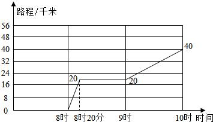

# Mathematics (Grade 5)

**ID**: 208acbf3
**难度**: hard
**题型**: short_answer

## 题目
暑假期间，李老师开车自驾游，他上午8时从家出发，10时到故宫博物院游玩，他在途中行车情况如下图．

（1）李老师从家到故宫博物院全长多少千米？平均每小时行多少千米？
（2）李老师在途中有没有停留？如果停留过，停留了多长时间？

## 解答

**答案**: 40, 20, 40

1. Step1:从统计图可知李老师从家到故宫博物院全长40千米
2. Step2:计算李老师从家到故宫博物院所用时间为10 - 8 = 2小时
3. Step3:根据路程÷时间=速度，计算平均速度为40÷2 = 20千米/小时
4. Step4:从统计图看出8时20分到9时路程不变，可知李老师途中有停留
5. Step5:计算停留时间为9时 - 8时20分 = 40分
6. Step6:将全长40千米、平均速度20千米/小时、停留时间40分按顺序整理为['40', '20', '40']

## 知识点

**知识点**:
  - 简单的行程问题;单式折线统计图

---
