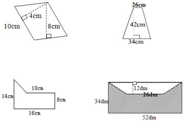

# Mathematics (Grade 5)

**ID**: 28300cf1
**难度**: hard
**题型**: short_answer

## 题目
求如图图形（有阴影的计算阴影）的面积

## 解答

**答案**: 40, 1260, 146, 1300

1. Step1:根据平行四边形面积公式S=ah，其中a=10厘米，h=4厘米，可得面积为10×4=40平方厘米
2. Step2:根据梯形面积公式S=(a+b)h÷2，其中a=26厘米，b=34厘米，h=42厘米，即(26+34)×42÷2=60×42÷2=1260平方厘米
3. Step3:将组合图形分割成一个三角形和一个长方形，三角形底为16 - 10 = 6厘米，高为14 - 8 = 6厘米，长方形长16厘米，宽8厘米，根据三角形面积公式S=ah÷2和长方形面积公式S=ab，可得面积为(14 - 8)×(16 - 10)÷2 + 16×8 = 6×6÷2 + 128 = 18 + 128 = 146平方厘米
4. Step4:根据长方形面积公式S=ab和梯形面积公式S=(a+b)h÷2，长方形长52分米，宽34分米，梯形上底26分米，下底52分米，高12分米，可得面积为52×34 - (52 + 26)×12÷2 = 1768 - 78×12÷2 = 1768 - 468 = 1300平方分米

## 知识点

**知识点**:
  - 平行四边形的面积;梯形的面积;组合图形的面积

---
