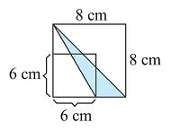

# Mathematics (Grade 5)

**ID**: 2e3bccbd
**难度**: hard
**题型**: short_answer

## 题目
求下图涂色部分的面积。      

## 解答

**答案**: 8

1. Step1:观察图形，确定涂色部分为三角形
2. Step2:分析得出三角形的底为8 - 6 = 2cm
3. Step3:明确三角形的高为大正方形的边长8cm
4. Step4:根据三角形面积公式，计算面积为2×8÷2 = 8cm²
5. Step5:得出答案为8

## 知识点

**知识点**:
  - 三角形的面积

---
