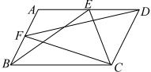

# Mathematics (Grade 5)

**ID**: 39b8754e
**难度**: hard
**题型**: short_answer

## 题目
判断。（对的打“√”，错的打“×”）
1.在同一平面内，两条直线不相交就一定平行。
2.一个长方形的长增加10%，宽减少10%，其面积不变。
3.有一组对边平行的四边形是梯形。
4.从直线外一点到直线的连线中，垂直线段最短。
5.如图，四边形ABCD是平行四边形，E、F分别是两条边的中点，三角形FCD与三角形BEC面积相等。

## 解答

**答案**: √, ×, ×, √, √

1. Step1:根据同一平面内直线的位置关系，不相交就平行，判断第1题说法正确，记为√
2. Step2:根据长方形面积公式S=长×宽，变化后面积为S=长×(1+10%)×宽×(1-10%)=0.99×长×宽，面积改变，判断第2题说法错误，记为×
3. Step3:依据梯形定义，只有一组对边平行且另一组对边不平行的四边形才是梯形，判断第3题说法错误，记为×
4. Step4:按照从直线外一点到直线连线中垂线最短的性质，判断第4题说法正确，记为√
5. Step5:根据平行四边形性质，三角形FCD与三角形BEC等底等高，结合三角形面积公式得出面积相等，判断第5题说法正确，记为√
6. Step6:将判断结果整理为['√', '×', '×', '√', '√']

## 知识点

**知识点**:
  - 梯形的认识;三角形的面积;长方形与正方形的面积;平行四边形的认识

---
