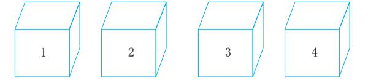

# Mathematics (Grade 5)

**ID**: 3ba189fc
**难度**: hard
**题型**: short_answer

## 题目
在一个袋子里装有4个正方体，每个正方体上写着一个数字（如图）。

两人轮流从袋子里取出一个小正方体，取得的正方体上写着几，则记几分，然后把取出的正方体放回袋子里，由下一个人继续摸取。
（1）摸出的正方体一共有几种可能性？
（2）每一种可能性大小相同吗？为什么？
（3）要想摸出“3”的可能性大，可以怎么做？

## 解答

**答案**: 4, $\\frac{1}{4}$, 增加写着3的正方体的个数

1. Step1:已知袋子里装有4个写有不同数字的正方体，所以摸出的正方体的可能性数量与正方体个数相同，一共有4种可能性
2. Step2:由于写有数字1，2，3，4的正方体都只有1个，总共有4个正方体，根据可能性计算方法，每一种被摸到的可能性为1÷4=$rac{1}{4}$，所以每一种可能性大小相同
3. Step3:根据可能性大小与数量的关系，数量越多，摸到的可能性越大，要想摸出“3”的可能性大，就要让写有数字“3”的正方体个数最多，即增加写着3的正方体的个数

## 知识点

**知识点**:
  - 可能性的大小

---
