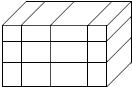

# Mathematics (Grade 5)

**ID**: 4c3ac0af
**难度**: hard
**题型**: short_answer

## 题目
一个长方体长是宽的2倍，也是高的2倍，如图12个长方体的表面积和是600平方厘米，求大长方体的体积．

## 解答

**答案**: 250

1. Step1:设大长方体左（右）面面积为x平方厘米，根据长是宽和高的2倍，得出大长方体前面、后面、上面和下面的面积都是2x平方厘米
2. Step2:计算切成12个小长方体后新增加的表面积为2x×3 + 2×2x×2 = 14x平方厘米
3. Step3:根据12个小长方体的表面积和是600平方厘米，列出方程2x×4 + 2x + 14x = 600
4. Step4:解方程24x = 600，得出x = 25平方厘米
5. Step5:由x = 25平方厘米，因为x是宽乘高，且宽和高相等，得出宽和高为5厘米
6. Step6:根据长是宽的2倍，得出长为5×2 = 10厘米
7. Step7:根据长方体体积公式，计算大长方体体积为5×5×10 = 250立方厘米

## 知识点

**知识点**:
  - 长方体和正方体的体积

---
