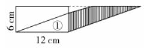

# Mathematics (Grade 5)

**ID**: 4e23ef8e
**难度**: hard
**题型**: short_answer

## 题目
如图，长方形的长是12cm， 宽是6cm，其中三角形①的面积是20cm$^{2}$，求阴影部分的面积。

## 解答

**答案**: 52

1. Step1:根据长方形面积公式S = a×b（其中a为长，b为宽），已知长方形长是12cm，宽是6cm，可得长方形面积为12×6 = 72cm²
2. Step2:由解析可知平行四边形与长方形等底等高，所以平行四边形面积等于长方形面积，即平行四边形面积为72cm²
3. Step3:因为阴影部分面积等于平行四边形面积减去三角形①的面积，三角形①面积是20cm²，所以阴影部分面积为72 - 20 = 52cm²

## 知识点

**知识点**:
  - 转化法求组合图形的面积(奥数)

---
