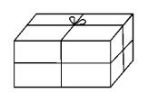

# Mathematics (Grade 5)

**ID**: 4e4690b7
**难度**: hard
**题型**: short_answer

## 题目
一个礼品盒，长30厘米，宽25厘米，高20厘米。
1.制作这个礼品盒至少需要多少平方厘米的硬纸板？
2.这个礼品盒所占的空间有多大？
3.如果要用红丝带按图中的方法把它捆扎起来，打结处要30厘米，那么至少需要多少厘米的红丝带？

## 解答

**答案**: 3700, 15000, 330

1. Step1:根据长方体表面积公式2×（长×宽+长×高+宽×高），代入长30厘米、宽25厘米、高20厘米，可得(30×25+30×20+25×20)×2，先计算括号内30×25=750，30×20=600，25×20=500，750+600+500=1850，再计算1850×2=3700平方厘米，此为制作礼品盒所需硬纸板面积
2. Step2:根据长方体体积公式长×宽×高，代入长30厘米、宽25厘米、高20厘米，可得30×25×20，先计算30×25=750，再计算750×20=15000立方厘米，此为礼品盒所占空间大小
3. Step3:根据捆扎方法，红丝带长度为4个长、4个宽、4个高的长度和加上打结处30厘米，即30×4+25×4+20×4+30，分别计算30×4=120，25×4=100，20×4=80，再计算120+100+80+30=330厘米，此为所需红丝带长度

## 知识点

**知识点**:
  - 长、正方体体积的计算;长、正方体表面积的计算;长方形与正方形的周长

---
