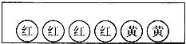

# Mathematics (Grade 5)

**ID**: 50597ac7
**难度**: hard
**题型**: short_answer

## 题目
盒子里装有6个弹子，它们除颜色不同外完全相同
游戏规则：①两人一组，轮流从盒子中摸弹子，每次摸出一个弹子后放回；②摸出红子弹的笑笑得1分，摸出黄弹子的贝贝得1分．
(1)你认为这个游戏规则公平吗？为什么？
(2)怎样做才能对游戏双方都公平？

## 解答

**答案**: 这个游戏不公平, 把其中一个红弹子换成黄弹子

1. Step1:判断游戏是否公平需看双方机会是否均等，计算笑笑得分可能性为4÷6=$\frac{2}{3}$，贝贝得分可能性为2÷6=$\frac{1}{3}$，双方得分可能性不相等，所以游戏不公平
2. Step2:为使游戏公平，需让双方机会均等，可将一个红弹子换成黄弹子，使红、黄弹子个数都为3，此时双方得分可能性都为3÷6=$\frac{1}{2}$

## 知识点

**知识点**:
  - 游戏规则的公平性．

---
