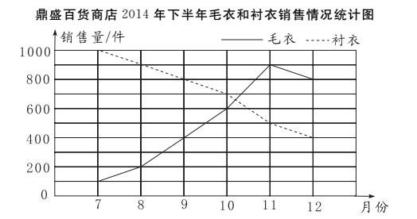

# Mathematics (Grade 5)

**ID**: 533c78ce
**难度**: hard
**题型**: short_answer

## 题目
下图是鼎盛百货商店2014年下半年毛衣和衬衣销售情况统计图，看图完成下面各题。

（1）毛衣的销售量哪个月最多，是多少件？
（2）下半年平均每月销售毛衣多少件？
（3）从这个统计图中你还能发现什么？

## 解答

**答案**: 900, 500, 随着天气逐渐转冷，衬衣销量减小，毛衣销量增加。

1. Step1:观察统计图中表示毛衣销售量的实线，找到最高点对应的月份为11月，其销售量为900件，得出毛衣销售量最多的月份是11月，销售量是900件
2. Step2:计算下半年毛衣总销售量，100+200+400+600+900+800 = 3000件，再计算平均每月销售量，3000÷6 = 500件
3. Step3:观察统计图中衬衣和毛衣销售量随月份的变化趋势，得出随着天气逐渐转冷，衬衣销量减小，毛衣销量增加

## 知识点

**知识点**:
  - 复式折线统计图

---
