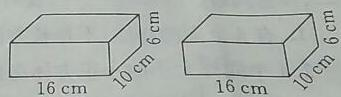

# Mathematics (Grade 5)

**ID**: 65a5439e
**难度**: hard
**题型**: short_answer

## 题目
把两个长16cm宽10cm，高6cm的长方体拼成一个大长方体，怎样拼得的大长方体的表面积最大？是多少平方厘米？怎样拼得的大长方体的表面积最小是多少平方厘米？

 16cm  6cm  10cm   16cm
  10cm  6cm

## 解答

**答案**: 1144, 1104

1. Step1:明确长方体表面积公式为长方体的表面积=2×(长×宽＋宽×高＋长×高)
2. Step2:计算单个长方体表面积为(16×10+16×6+10×6)×2
3. Step3:计算两个长方体表面积为(16×10+16×6+10×6)×2×2
4. Step4:因为把最小的面（6×10）拼接在一起，表面积最大，所以最大表面积为(16×10+16×6+10×6)×2×2 - 10×6×2，计算得(160+96+60)×4 - 120 = 316×4 - 120 = 1264 - 120 = 1144平方厘米
5. Step5:因为把最大的面（16×10）拼接在一起，表面积最小，所以最小表面积为(16×10+16×6+10×6)×2×2 - 16×10×2，计算得(160+96+60)×4 - 160 = 316×4 - 160 = 1264 - 160 = 1104平方厘米

## 知识点

**知识点**:
  - 

---
