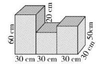

# Mathematics (Grade 5)

**ID**: 690b88a6
**难度**: hard
**题型**: short_answer

## 题目
一个机器零件（如下图），要在它的前后两个面涂上红色防锈漆，其他漏出的面（底面不涂）涂上灰色防锈漆。涂红色防锈漆和灰色防锈漆的面积各是多少？

## 解答

**答案**: 9000, 6900

1. Step1:计算前面单个面中长60厘米、宽30厘米长方形的面积，60×30 = 1800平方厘米
2. Step2:计算前面单个面中长(60 - 20)厘米、宽30厘米长方形的面积，(60 - 20)×30 = 1200平方厘米
3. Step3:计算前面单个面中长50厘米、宽30厘米长方形的面积，50×30 = 1500平方厘米
4. Step4:将前面单个面中三个长方形面积相加，1800 + 1200 + 1500 = 4500平方厘米
5. Step5:计算涂红色防锈漆的面积，4500×2 = 9000平方厘米
6. Step6:计算涂灰色防锈漆时，左面的面的面积，60×30 = 1800平方厘米
7. Step7:计算涂灰色防锈漆时，右面的面的面积，50×30 = 1500平方厘米
8. Step8:计算涂灰色防锈漆时，中间两个侧面中一个长30厘米、宽20厘米面的面积，30×20 = 600平方厘米
9. Step9:计算涂灰色防锈漆时，中间两个侧面中另一个面的面积，30×[20-(60 - 50)] = 30×10 = 300平方厘米
10. Step10:计算涂灰色防锈漆时，上面3个面的面积，30×30×3 = 2700平方厘米
11. Step11:计算涂灰色防锈漆的面积，1800 + 1500 + 2700 + 600 + 300 = 6900平方厘米

## 知识点

**知识点**:
  - 不规则立体图形的表面积

---
