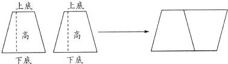

# Mathematics (Grade 5)

**ID**: 6a062e78
**难度**: hard
**题型**: short_answer

## 题目
如下图，请回忆老师引导你推导梯形面积公式的过程．

(1)把两个完全一样的梯形转化成平行四边形，其方法是______．
A．旋转 B．平移 C．旋转和平移
(2)观察转化前的梯形与转化后的平行四边形，你发现了什么？(至少写三条．)
(3)计算上面梯形的面积．(先动手在图中量出计算时需要的数据，再算出它的面积．)

## 解答

**答案**: C, 平行四边形的底等于梯形的上下底之和，平行四边形的高等于梯形的高，平行四边形的面积等于两个梯形的面积之和, 3平方厘米

1. Step1:对于把两个完全一样的梯形转化成平行四边形的方法，将其中一个梯形先旋转180度，再平移，就能与另一个梯形拼成平行四边形，所以答案选C
2. Step2:观察转化前后图形，因为拼接方式，可得平行四边形的底等于梯形的上下底之和；由于拼接时高的位置和长度未变，所以平行四边形的高等于梯形的高；又因为是两个梯形拼成一个平行四边形，所以平行四边形的面积等于两个梯形的面积之和
3. Step3:动手测量图中梯形，量得梯形的上底是1厘米、下底是2厘米、高是2厘米，根据梯形面积公式（上底 + 下底）×高÷2，可得(1 + 2)×2÷2 = 3平方厘米

## 知识点

**知识点**:
  - 梯形的面积;图形的拼组．

---
