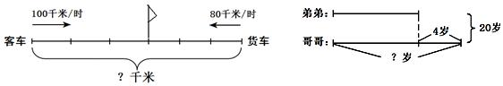

# Mathematics (Grade 5)

**ID**: 6db300a6
**难度**: hard
**题型**: short_answer

## 题目
看图列式并计算

## 解答

**答案**: 540, 12

1. Step1:分析客车和货车行程图，确定客车速度为100千米/时，货车速度为80千米/时，相遇时间为3小时
2. Step2:根据“路程=速度×时间”，计算两车速度之和为100 + 80 = 180千米/时
3. Step3:用速度之和乘以相遇时间，得到两地距离为180×3 = 540千米
4. Step4:分析哥哥和弟弟年龄图，设弟弟年龄为x岁，则哥哥年龄为x + 4岁
5. Step5:根据哥哥和弟弟年龄之和为20岁，列出方程x + (x + 4) = 20
6. Step6:解方程2x + 4 = 20，先两边同时减4得2x = 16，再两边同时除以2得x = 8
7. Step7:计算哥哥年龄为8 + 4 = 12岁

## 知识点

**知识点**:
  - 图文应用题

---
