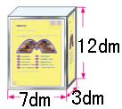

# Mathematics (Grade 5)

**ID**: 7689e85c
**难度**: hard
**题型**: short_answer

## 题目
一种长方体广告灯箱（如图），框架由铝合金条制成，四周围用灯箱布围成．
（1）制作这样一个灯箱至少需要铝合金条多少分米？
（2）灯箱的四周（不含上下面）围有灯箱布，至少需要灯箱布多少平方分米？

## 解答

**答案**: 88, 240

1. Step1:根据题意，求制作灯箱所需铝合金条长度，就是求长方体棱长之和，已知长方体棱长和公式为(长 + 宽 + 高)×4，此灯箱长7分米、宽3分米、高12分米，代入可得(7 + 3 + 12)×4
2. Step2:先计算括号内7 + 3 + 12 = 22，再计算22×4 = 88分米，这就是制作灯箱至少需要的铝合金条长度
3. Step3:求灯箱四周灯箱布面积，即求长方体侧面四个面的面积和，侧面由两个长×高的面和两个宽×高的面组成，所以面积和为(7×12 + 3×12)×2
4. Step4:先分别计算7×12 = 84，3×12 = 36，再计算括号内84 + 36 = 120，最后计算120×2 = 240平方分米，这就是至少需要的灯箱布面积

## 知识点

**知识点**:
  - 长方体、正方体表面积与体积计算的应用

---
