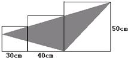

# Mathematics (Grade 5)

**ID**: 79eb744a
**难度**: hard
**题型**: short_answer

## 题目
如图，三个正方形的边长分别为：30cm、40cm、50cm．求阴影部分的面积．

## 解答

**答案**: 3000

1. Step1:确定阴影部分可转化为一个大三角形，其底为三个正方形边长之和，即30 + 40 + 50 = 120cm
2. Step2:明确大三角形的高为50cm
3. Step3:根据三角形面积公式S = 底×高÷2，计算大三角形面积为120×50÷2
4. Step4:得出120×50÷2 = 3000平方厘米，即阴影部分面积为3000平方厘米

## 知识点

**知识点**:
  - 组合图形的面积．

---
