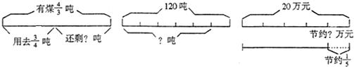

# Mathematics (Grade 5)

**ID**: 7c247400
**难度**: hard
**题型**: short_answer

## 题目
看图列算式计算．

## 解答

**答案**: $\frac{7}{12}$, 100, 4

1. Step1:计算还剩下的煤的重量，已知有煤$rac{4}{3}$吨，用去$rac{3}{4}$吨，根据减法运算，用总重量减去用去的重量，即$rac{4}{3}$ - $rac{3}{4}$ = $rac{16}{12}$ - $rac{9}{12}$ = $rac{7}{12}$吨
2. Step2:计算120吨的$rac{5}{6}$是多少吨，把120吨看作单位“1”，根据一个数乘分数的意义，用乘法计算，即120×$rac{5}{6}$ = 100吨
3. Step3:计算节约的钱数，把20万元看作单位“1”，节约了$rac{1}{5}$，根据一个数乘分数的意义，用乘法计算，即20×$rac{1}{5}$ = 4万元

## 知识点

**知识点**:
  - 图文应用题．

---
