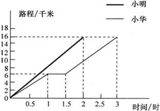

# Mathematics (Grade 5)

**ID**: 7c3d20d0
**难度**: hard
**题型**: short_answer

## 题目
下面是小明和小华两位同学从A地出发，骑自行车在同一条路上行驶到B地的折线统计图．请看图回答问题．

（1）小明和小华两位同学谁先到达B地？
（2）哪位同学在中途休息了，休息了多长时间？
（3）小华同学每小时走多少千米？

## 解答

**答案**: 小明, 小华, 0.5, 6.4

1. Step1:观察统计图可知小明和小华都走了16千米，小明用时2小时，小华用时3小时，因为2小时小于3小时，所以小明先到达B地，得出第一个答案为小明
2. Step2:观察统计图，发现小华在1小时到1.5小时路程没有增加，所以小华中途休息了，1.5 - 1 = 0.5小时，得出第二个答案为小华，第三个答案为0.5
3. Step3:小华走的路程是16千米，总用时3小时，中途休息0.5小时，实际行走时间是3 - 0.5 = 2.5小时，16÷2.5 = 6.4千米，得出第四个答案为6.4

## 知识点

**知识点**:
  - 复式折线统计图

---
