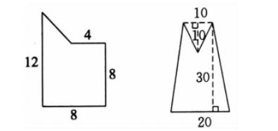

# Mathematics (Grade 5)

**ID**: 7c8a7d07
**难度**: hard
**题型**: short_answer

## 题目
计算下列图形的面积。（ 单位：cm）

## 解答

**答案**: 72, 400

1. Step1:计算第一个图形中正方形的面积，根据正方形面积公式S=a²（a为边长），可得8×8=64（cm²）
2. Step2:计算第一个图形中三角形的底，12 - 8 = 4（cm）
3. Step3:计算第一个图形中三角形的高，8 - 4 = 4（cm）
4. Step4:根据三角形面积公式S=ah÷2（a为底，h为高），计算第一个图形中三角形的面积为4×4÷2 = 8（cm²）
5. Step5:计算第一个图形的面积，为正方形面积与三角形面积之和，即64 + 8 = 72（cm²）
6. Step6:计算第二个图形中梯形的面积，根据梯形面积公式S=(a + b)h÷2（a为上底，b为下底，h为高），可得(10 + 20)×30÷2 = 450（cm²）
7. Step7:计算第二个图形中三角形的面积，根据三角形面积公式S=ah÷2（a为底，h为高），可得10×10÷2 = 50（cm²）
8. Step8:计算第二个图形的面积，为梯形面积与三角形面积之差，即450 - 50 = 400（cm²）

## 知识点

**知识点**:
  - 组合图形的面积

---
