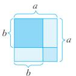

# Mathematics (Grade 5)

**ID**: 80419601
**难度**: hard
**题型**: short_answer

## 题目
我们知道(a+b)$^{2}$=a$^{2}$+2ab+b$^{2}$，你能利用下图发现(a-b)$^{2}$用字母怎样表示吗？

## 解答

**答案**: a^2-2ab+b^2

1. Step1:观察图形，确定大正方形的边长为a，根据正方形面积公式S = 边长×边长，可得大正方形面积为a×a = a²
2. Step2:确定左上角小正方形的边长为b，同样根据正方形面积公式，可得其面积为b×b = b²
3. Step3:确定另外两个小长方形的长为b，宽为a - b，根据长方形面积公式S = 长×宽，可知每个小长方形面积为b(a - b)
4. Step4:因为(a - b)²表示右下角小正方形的面积，其面积等于大正方形面积减左上角小正方形面积，再减去两个小长方形的面积
5. Step5:将各部分面积代入计算，即(a - b)² = a² - b² - 2b(a - b)
6. Step6:对a² - b² - 2b(a - b)进行化简，a² - b² - 2ab + 2b² = a² - 2ab + b²

## 知识点

**知识点**:
  - 用字母表示数

---
