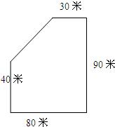

# Mathematics (Grade 5)

**ID**: 8a8da98a
**难度**: hard
**题型**: short_answer

## 题目
甲鱼池的形状如图所示，已知每平米放养甲鱼苗200只．
（1）求甲鱼池的面积是多少平方米？
（2）总共能放养多少只甲鱼苗？

## 解答

**答案**: 59500, 1190000

1. Step1:将甲鱼池分解为一个梯形和一个长方形，梯形的上底为30米，下底为80米，高为90 - 40 = 50米；长方形的长为80米，宽为40米
2. Step2:根据梯形面积公式S=(a + b)×h÷2（其中a为上底，b为下底，h为高），计算梯形面积为(30 + 80)×(90 - 40)÷2 = 110×50÷2 = 2750平方米
3. Step3:根据长方形面积公式S = a×b（其中a为长，b为宽），计算长方形面积为40×80 = 3200平方米
4. Step4:将梯形面积和长方形面积相加，得到甲鱼池面积为2750 + 3200 = 5950平方米
5. Step5:已知每平米放养甲鱼苗200只，用甲鱼池面积5950平方米乘200，计算出总共能放养甲鱼苗的数量为5950×200 = 1190000只

## 知识点

**知识点**:
  - 组合图形的面积．

---
