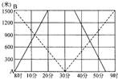

# Mathematics (Grade 5)

**ID**: 8c9f4641
**难度**: hard
**题型**: short_answer

## 题目
如图，A，B两地相距1500米，实线表示甲上午8时由A地出发往B地行走，到达B地后稍作休息，又从B地出发返回A地的步行情况；又虚线表示乙上午8时从B地出发向A地行走，到了A地，立即返回B地的步行情况．
(1)观察此图，解下列问题：
①甲在B地休息了多长时间？算一算，休息前、后步行的速度各是多少？
②乙从B地到A地，又从A地到B地的步行速度各是多少？
(2)甲、乙二人在途中相遇两次，结合图形、算一算，第一次，第二次相遇的时刻各是几点几分？

## 解答

**答案**: 20, 75, 83.3, 50, 50, 12, 41.25

1. Step1:计算甲在B地休息时间，由图可知甲到达B地时间为20分钟，再次出发时间为40分钟，所以休息时间为40 - 20 = 20分钟
2. Step2:计算甲休息前步行速度，A、B两地相距1500米，甲休息前用时20分钟到达B地，速度为1500÷20 = 75米/分钟
3. Step3:计算甲休息后步行速度，甲返回时走1500米用时54 - 36 = 18分钟，速度为1500÷18≈83.3米/分钟
4. Step4:计算乙从B地到A地步行速度，乙从B地到A地用时30分钟，路程为1500米，速度为1500÷30 = 50米/分钟
5. Step5:计算乙从A地到B地步行速度，乙从A地到B地用时30分钟，路程为1500米，速度为1500÷30 = 50米/分钟
6. Step6:计算甲、乙第一次相遇时刻，两人相向而行，总路程为1500米，速度和为75 + 50 = 125米/分钟，相遇时间为1500÷125 = 12分钟
7. Step7:计算甲、乙第二次相遇时刻，甲返回时两人相向而行，此时总路程为1500米，甲返回速度约83.3米/分钟，速度和为83.3 + 50 = 133.3米/分钟，相遇用时1500÷133.3≈11.25分钟，再加上乙从B地到A地用时30分钟，所以第二次相遇时刻为11.25 + 30 = 41.25分钟

## 知识点

**知识点**:
  - 复式折线统计图;简单的行程问题;相遇问题．

---
