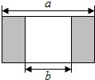

# Mathematics (Grade 5)

**ID**: 918f33f1
**难度**: hard
**题型**: short_answer

## 题目
如图，空白部分是一个正方形．
（1）求空白部分的周长和面积；
（2）求阴影部分的周长和面积；
（3）当a=1.6m，b=0.8m时，阴影部分的面积是多少？

## 解答

**答案**: 4b, b^2, 2a+2b, ab-b^2, 0.64

1. Step1:根据正方形周长公式，空白部分周长为b×4=4b
2. Step2:根据正方形面积公式，空白部分面积为b×b=b**2
3. Step3:根据长方形周长公式，阴影部分周长为(a + b)×2=2a + 2b
4. Step4:用大长方形面积减去空白正方形面积，阴影部分面积为a×b - b×b=ab - b**2
5. Step5:将a=1.6m，b=0.8m代入ab - b**2，即1.6×0.8 - 0.8**2=1.28 - 0.64=0.64

## 知识点

**知识点**:
  - 用字母表示数;含字母式子的求值

---
