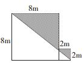

# Mathematics (Grade 5)

**ID**: 96bacabe
**难度**: hard
**题型**: short_answer

## 题目
求下图阴影部分的面积。（ 单位：米）

## 解答

**答案**: 28

1. Step1:计算边长为8米的正方形的面积，根据正方形面积公式S=a²（a为边长），可得8×8 = 64平方米
2. Step2:计算边长为2米的正方形的面积，根据正方形面积公式可得2×2 = 4平方米
3. Step3:计算两个正方形的面积和，即64 + 4 = 68平方米
4. Step4:计算空白部分三角形的底，为8 + 2 = 10米
5. Step5:根据三角形面积公式S=ah÷2（a为底，h为高），计算空白部分三角形面积，即10×8÷2 = 40平方米
6. Step6:用两个正方形的面积和减去空白三角形的面积，即68 - 40 = 28平方米

## 知识点

**知识点**:
  - 组合图形的面积

---
