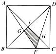

# Mathematics (Grade 5)

**ID**: a091d036
**难度**: hard
**题型**: short_answer

## 题目
如图，正方形ABCD的面积为1，BF=2FC，     求阴影四边形FHJG的面积．

## 解答

**答案**: $\frac{3}{40}$

1. Step1:设正方形ABCD的边长为a，由正方形ABCD的面积为1，可得a² = 1
2. Step2:因为BF = 2FC，所以BF = 2a/3，FC = a/3
3. Step3:计算△ABF的面积，S_{△ABF}=1/2×a×2a/3 = a²/3 = 1/3
4. Step4:计算△DCF的面积，S_{△DCF}=1/2×a×a/3 = 1/6a² = 1/6
5. Step5:由于BF∥AD，得出△BGF∽△DGA，进而得到FG：GA = 2a/3：a = 2：3，FG：FA = 2：5
6. Step6:计算△BGF的面积，S_{△BGF}=S_{△ABF}×2/5 = 2/15
7. Step7:同理，计算△CHF的面积，S_{△CHF}=1/4S_{△DCF}=1/24
8. Step8:已知S_{△BJC}=1/4，得出阴影四边形FHJG的面积=S_{△BJC}-(S_{△BGF}+S_{△CHF})
9. Step9:计算阴影四边形FHJG的面积为1/4-(2/15 + 1/24)=1/4 - 7/40 = 3/40

## 知识点

**知识点**:
  - 组合图形的面积．

---
