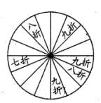

# Mathematics (Grade 5)

**ID**: ac08acbc
**难度**: hard
**题型**: short_answer

## 题目
某饭店为了吸引顾客，设立一个可以转动的转盘（如图所示），规定顾客消费100元以上（不包括100元）就获得一次转动转盘的机会，转盘停止后，指针正好对着九折、八折、七折的哪个区域，顾客就获得此待遇（转盘16等分）。
（1）李阿姨消费120元，她获得打折的机会有多大？获得九折、八折、七折的可能性各是多少？
（2）张叔叔消费95元，他获得打折的可能性是多少？

## 解答

**答案**: 37.5%, 18.75%, 12.5%, 6.25%, 0

1. Step1:判断李阿姨是否满足条件，因为120＞100，所以李阿姨有转动转盘机会
2. Step2:计算李阿姨获得打折的可能性，转盘共16等分，九折、八折、七折区域共6份，6÷16 = 37.5%
3. Step3:计算李阿姨获得九折的可能性，九折区域有3份，3÷16 = 18.75%
4. Step4:计算李阿姨获得八折的可能性，八折区域有2份，2÷16 = 12.5%
5. Step5:计算李阿姨获得七折的可能性，七折区域有1份，1÷16 = 6.25%
6. Step6:判断张叔叔是否满足条件，因为95＜100，所以张叔叔没有转动转盘机会，获得打折可能性为0

## 知识点

**知识点**:
  - 小学数学;统计和概率;可能性;简单事件发生的可能性求解

---
