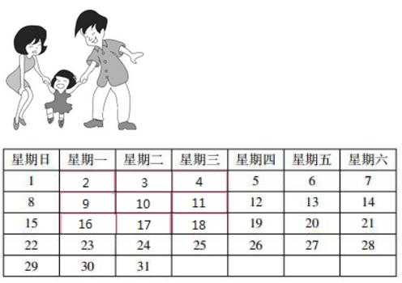

# Mathematics (Grade 5)

**ID**: afa1da50
**难度**: hard
**题型**: short_answer

## 题目
欣欣的爸爸是一名警察，每工作2天休息1天，欣欣的妈妈是一名医生，每工作3天休息1天，欣欣周六、周日休息。1月3日开始，大家都开始工作或学习，如果欣欣希望和爸爸和妈妈一起去游乐园，那么1月份的哪天可以实现她的愿望？（可参考下图中的日历）

## 解答

**答案**: 1月14日

1. Step1:根据1月3日开始工作或学习，得出1月2日爸爸、妈妈和欣欣都在休假
2. Step2:分析爸爸的工作休息规律，得出爸爸每3天休假1次
3. Step3:分析妈妈的工作休息规律，得出妈妈每4天休假1次
4. Step4:因为欣欣周六、周日休息，所以不论周六还是周日休息，经过6天后欣欣还会休假
5. Step5:求出3、4、6这三个数的最小公倍数为12
6. Step6:从1月2日开始经过12天，计算得出是1月14日

## 知识点

**知识点**:
  - 最小公倍数的应用(奥数)

---
