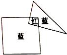

# Mathematics (Grade 5)

**ID**: b6f122ed
**难度**: hard
**题型**: short_answer

## 题目
如图，若红色部分占三角形面积的$\frac{1}{4}$，占正方形面积的$\frac{1}{18}$，求正方形中蓝色部分的面积是三角形中蓝色部分面积的多少倍？

## 解答

**答案**: $\frac{17}{3}$

1. Step1:设红色部分面积为1。因为红色部分占三角形面积的$\frac{1}{4}$，根据已知一个数的几分之几是多少，求这个数用除法，所以三角形面积为1÷$\frac{1}{4}$=4。
2. Step2:因为红色部分占正方形面积的$\frac{1}{18}$，同理可得正方形面积为1÷$\frac{1}{18}$=18。
3. Step3:计算正方形中蓝色部分的面积，用正方形面积减去红色部分面积，即18 - 1 = 17。
4. Step4:计算三角形中蓝色部分的面积，用三角形面积减去红色部分面积，即4 - 1 = 3。
5. Step5:求正方形中蓝色部分的面积是三角形中蓝色部分面积的多少倍，用正方形中蓝色部分面积除以三角形中蓝色部分面积，即17÷3 = $\frac{17}{3}$。

## 知识点

**知识点**:
  - 重叠问题

---
