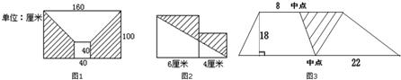

# Mathematics (Grade 5)

**ID**: b81c7e70
**难度**: hard
**题型**: short_answer

## 题目
计算下面各图形的面积：（单位：cm）

## 解答

**答案**: 8400, 22, 72

1. Step1:计算图1单个阴影梯形面积，先算上底40厘米、下底100厘米、高为(160 - 40)÷2 = 60厘米，根据梯形面积公式S=(a + b)×h÷2，可得单个阴影梯形面积为(40 + 100)×60÷2，再乘2得到阴影部分面积为[(40 + 100)×(160 - 40)÷2]÷2×2 = 8400平方厘米
2. Step2:计算图2阴影部分面积，先算出两个正方形面积分别为6×6和4×4，再算出空白三角形面积，底为6 + 4 = 10厘米，高为6厘米，根据三角形面积公式S = a×h÷2，空白三角形面积为(6 + 4)×6÷2，最后用两个正方形面积和减去空白三角形面积，即6×6 + 4×4 - (6 + 4)×6÷2 = 22平方厘米
3. Step3:计算图3阴影部分面积，根据三角形面积公式S = a×h÷2，底为8厘米，高为18厘米，可得8×18÷2 = 72平方厘米

## 知识点

**知识点**:
  - 组合图形的面积

---
