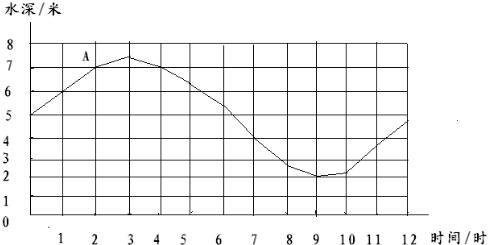

# Mathematics (Grade 5)

**ID**: c0d98b56
**难度**: hard
**题型**: short_answer

## 题目
如图是某港口从0到12时的水深情况．
（1）大约什么时候港口的水最深？
（2）大约什么时候港口的水最浅？深度约是多少？
（3）在什么时间范围内，港口水深在减少？
（4）在什么时间范围内，港口水深在增加？
（5）什么时刻水的深度与A点表示的深度相同？
（6）这个港口从0时到12时的水深是如何变化的？

## 解答

**答案**: 3时, 9时,3米, 3时到9时, 0时到2时,9时到12时, 4时, 先上升在下降，然后在上升

1. Step1:观察折线统计图的横轴和纵轴，找到水深的最高点对应的横轴时间，得出大约3时港口的水最深
2. Step2:观察折线统计图的横轴和纵轴，找到水深的最低点对应的横轴时间和纵轴深度，得出大约9时港口的水最浅，深度约是3米
3. Step3:观察折线统计图中水深呈下降趋势对应的时间范围，得出从3时到9时港口水深在减少
4. Step4:观察折线统计图中水深呈上升趋势对应的时间范围，得出从0时到2时，从9时到12时港口水深在增加
5. Step5:确定A点表示的深度为7米，在图中找到同样深度为7米对应的时间，得出4时水的深度与A点表示的深度相同
6. Step6:整体观察折线统计图的走势，得出这个港口从0时到12时的水深变化为先上升再下降，然后再上升

## 知识点

**知识点**:
  - 单式折线统计图

---
