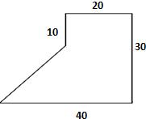

# Mathematics (Grade 5)

**ID**: c795367c
**难度**: hard
**题型**: short_answer

## 题目
用两种方法求下面组合图形的面积．（单位：dm）

## 解答

**答案**: 800, 800

1. Step1:第一种方法，将原图形分隔成1个长方形和1个梯形，长方形的长为20dm，宽为10dm，根据长方形面积公式S=ab，其面积为20×10=200平方分米；梯形的上底为20dm，下底为40dm，高为30 - 10 = 20dm，根据梯形面积公式S=(a + b)×h÷2，其面积为(20 + 40)×(30 - 10)÷2=60×20÷2 = 600平方分米，组合图形面积为200 + 600 = 800平方分米
2. Step2:第二种方法，将原图形分隔成一个三角形和一个长方形，长方形的长为30dm，宽为20dm，根据长方形面积公式S=ab，其面积为30×20 = 600平方分米；三角形的底为40 - 20 = 20dm，高为30 - 10 = 20dm，根据三角形面积公式S=a×h÷2，其面积为(40 - 20)×(30 - 10)÷2=20×20÷2 = 200平方分米，组合图形面积为600 + 200 = 800平方分米

## 知识点

**知识点**:
  - 组合图形的面积

---
