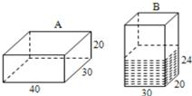

# Mathematics (Grade 5)

**ID**: d21a2fbd
**难度**: hard
**题型**: short_answer

## 题目
现有空的长方体容器A和水深24厘米的长方体容器B（如图），要将容器B的水倒一部分给A，使两容器的水的高度相同，这时A容器和B容器中水的体积各是多少立方厘米？

## 解答

**答案**: 9600, 4800

1. Step1:设两个容器的水深相同为x厘米
2. Step2:根据两个容器内水的体积之和等于B容器中高为24厘米时的水的体积，列出方程40×30×x + 30×20×x = 30×20×24
3. Step3:计算方程左边为1200x + 600x = 1800x，得到1800x = 14400
4. Step4:求解方程得出x = 8
5. Step5:计算A容器中水的体积为40×30×8 = 9600立方厘米
6. Step6:计算B容器中水的体积为30×20×8 = 4800立方厘米

## 知识点

**知识点**:
  - 长方体和正方体的体积

---
