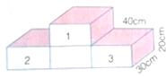

# Mathematics (Grade 5)

**ID**: d9486690
**难度**: hard
**题型**: short_answer

## 题目
如图的领奖台由四个相同的长方体木块拼合而成，在它的前、后两面涂上白色油漆，上面和侧面铺上红色地毯．
（1）需要油漆部分面积是多少；
（2）做这个领奖台需要多少立方米木料？
（3）想一想，地毯展开后是什么图形，面积是多少？

## 解答

**答案**: 6400, 0.096, 6000

1. Step1:计算需要油漆部分面积，根据长方形面积公式S=长×宽，前后面分别有4个长40厘米、宽20厘米的长方形，所以面积为40×20×4×2 = 6400平方厘米
2. Step2:计算做领奖台所需木料体积，根据长方体体积公式v = a×b×h，先算出一个长方体体积为40×30×20，再乘以4得到40×30×20×4 = 96000立方厘米，最后将单位换算为立方米，即96000立方厘米 = 0.096立方米
3. Step3:计算地毯面积，先算出地毯展开后长方形的长为20×4 + 40×3 = 200厘米，宽为30厘米，再根据长方形面积公式可得面积为200×30 = 6000平方厘米

## 知识点

**知识点**:
  - 长方体和正方体的表面积

---
