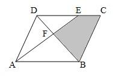

# Mathematics (Grade 5)

**ID**: d96098ec
**难度**: hard
**题型**: short_answer

## 题目
如图，已知平行四边形ABCD的面积为12cm$^{2}$，CE=$\frac{1}{3}$CD，AE与BD的交点为F，求图中阴影部分的面积？

## 解答

**答案**: 4$\\frac{2}{5}$

1. Step1:根据平行四边形性质，因为ABCD是平行四边形，所以CD∥AB，由此可得\(\frac{DE}{AB}=\frac{EF}{FA}\)
2. Step2:由CE=\(\frac{1}{3}\)CD，可得DE=\(\frac{2}{3}\)CD，又因为AB=CD，所以\(\frac{DE}{AB}=\frac{2}{3}\)，即EF：FA = 2：3
3. Step3:计算△AED的面积，根据三角形面积公式，△AED的面积=\(\frac{2}{3}\)×CD×h÷2（h为平行四边形ABCD的高），由于平行四边形ABCD面积为12\(cm^{2}\)，即CD×h = 12，所以△AED的面积=\(\frac{2}{3}\)×12÷2 = 4平方厘米
4. Step4:计算△DFE的面积，因为EF：FA = 2：3，所以△DFE的面积=4÷(2 + 3)×2 = \(\frac{8}{5}\)平方厘米
5. Step5:计算△BCD的面积，因为△BCD的面积=\(\frac{1}{2}\)平行四边形ABCD的面积，所以△BCD的面积=12×\(\frac{1}{2}\)=6平方厘米
6. Step6:计算阴影部分面积，用△BCD的面积减去△DEF的面积，即6 - \(\frac{8}{5}\)=\(\frac{22}{5}\)=4\(\frac{2}{5}\)平方厘米

## 知识点

**知识点**:
  - 组合图形的面积．

---
