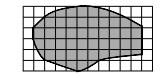

# Mathematics (Grade 5)

**ID**: d9f77ffe
**难度**: hard
**题型**: short_answer

## 题目
如下图，在方格图上绘制一个池塘的轮廓图，每个小方格表示1公顷，这个池塘的面积大约是多少公顷？

## 解答

**答案**: 43.5

1. Step1:明确采用数格点的方法估算面积，未满一格算半格
2. Step2:数第一行，有4个半格，3个整格，计算可得共4÷2+3=5格
3. Step3:数第二行，有2个半格，8个整格，计算可得共2÷2+8=9格
4. Step4:数第三行，有10个整格，共10格
5. Step5:数第四行，有1个半格，9个整格，计算可得共1÷2+9=9.5格
6. Step6:数第五行，有5个半格，5个整格，计算可得共5÷2+5=7.5格
7. Step7:数第六行，有5个半格，计算可得共5÷2=2.5格
8. Step8:将六行的格子数相加，5+9+10+9.5+7.5+2.5=43.5格
9. Step9:因为每个小方格表示1公顷，所以池塘面积大约是43.5×1=43.5公顷

## 知识点

**知识点**:
  - 组合图形的面积

---
