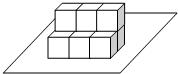

# Mathematics (Grade 5)

**ID**: e0734444
**难度**: hard
**题型**: short_answer

## 题目
将棱长为2厘米的小正方体按图方式摆放在地上，露在外面的面积是多少？体积是多少？

## 解答

**答案**: 96平方厘米, 72立方厘米

1. Step1:分析露在外面的面的数量，从前、后面看有12个边长2厘米的正方形的面，从上面看有6个，从侧面看有6个，所以露在外面的总面数为12+6+6=24个
2. Step2:计算一个正方形面的面积，根据正方形面积公式，边长为2厘米，面积为2×2=4平方厘米
3. Step3:计算露在外面的总面积，用一个面的面积乘以总面数，即4×24=96平方厘米
4. Step4:计算一个小正方体的体积，根据正方体体积公式，棱长为2厘米，体积为2×2×2=8立方厘米
5. Step5:数出立体图形由9个小正方体组成
6. Step6:计算立体图形的总体积，用一个小正方体体积乘以个数，即8×9=72立方厘米

## 知识点

**知识点**:
  - 规则立体图形的表面积．

---
