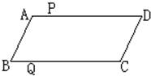

# Mathematics (Grade 5)

**ID**: e8bd8eff
**难度**: hard
**题型**: short_answer

## 题目
平行四边形ABCD的周长72厘米，CD=12厘米，P点以每秒2厘米的速度从A点出发到D；Q点以每秒8厘米的速度从B出发在BC间不停顿地做往返运动，线段PQ第三次把平行四边形ABCD二等分时，Q点距C点多少厘米？（必须写出解题思路和解答过程）

## 解答

**答案**: 8

1. Step1:根据平行四边形周长公式，已知平行四边形ABCD周长72厘米，CD = 12厘米，由于平行四边形对边相等，可得AD = BC = (72 - 12×2)÷2 = 24厘米
2. Step2:分析线段PQ把平行四边形ABCD二等分的情况，得出第三次二等分时，P行驶的路程=Q行驶的路程 - 24×2
3. Step3:设经过x秒后，PQ第三次把平行四边形ABCD二等分，根据P点速度每秒2厘米，Q点速度每秒8厘米，列出方程2x = 8x - 24×2
4. Step4:解方程2x = 8x - 24×2，即6x = 48，解得x = 8
5. Step5:计算Q点一共行驶的路程为8×8 = 64厘米
6. Step6:计算Q点距离C点的距离，因为Q点在BC间不停顿做往返运动，所以距离C点为24×3 - 64 = 8厘米

## 知识点

**知识点**:
  - 环形跑道问题．

---
