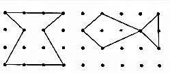

# Mathematics (Grade 5)

**ID**: f7f16e88
**难度**: hard
**题型**: short_answer

## 题目
判断下列图形是否为格点多边形，并求出格点多边形的面积．（图中水平、竖直方向相邻两个格点的距离均为1）．

## 解答

**答案**: 7, 4

1. Step1:根据格点多边形定义，判断顶点在网格交点的多边形为格点多边形，得出两个图形均为格点多边形
2. Step2:对于第一个图形，使用格点面积公式格点面积=内部格点数+周界格点数÷2-1，可得其面积为2+10÷2=7
3. Step3:对于第二个图形，其面积等于底为3、高为1的两个三角形面积和加上一个底为2、高为1的三角形面积，即3×1÷2×2+2×1÷2=4

## 知识点

**知识点**:
  - 格点面积（毕克定理）

---
