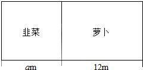

# Mathematics (Grade 5)

**ID**: fe89af18
**难度**: hard
**题型**: short_answer

## 题目
如图是王大伯家的两块菜地，一块是正方形的韭菜地，另一块是长方形的萝卜地．
（1）韭菜地的面积是多少？
（2）萝卜地的面积是多少？
（3）求当a=6时，这块地的面积是多少？

## 解答

**答案**: a**2, 12*a, 108

1. Step1:根据正方形面积公式，韭菜地为正方形，边长为a，其面积为a×a=a**2
2. Step2:根据长方形面积公式，萝卜地为长方形，长为12，宽为a，其面积为12×a=12*a
3. Step3:当a=6时，韭菜地面积a**2=6*6=36，萝卜地面积12*a=12*6=72，这块地总面积为36+72=108

## 知识点

**知识点**:
  - 用字母表示数;长方形、正方形的面积

---
