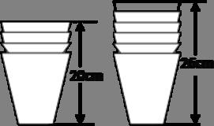

# Mathematics (Grade 5)

**ID**: 044edfba
**难度**: medium_easy
**题型**: fill_in_the_blank

## 题目
把一些规则大小相同的杯子叠起来，四个杯子叠起来高20厘米，6个杯子叠起来高26厘米，20个杯子叠起来有（__________）厘米。

## 解答

**答案**: 68

1. Step1:先计算每多叠一个杯子增加的高度，由6个杯子高26厘米，4个杯子高20厘米，可得每多叠一个杯子增加的高度为(26 - 20)÷(6 - 4)=3厘米
2. Step2:计算一个杯子除重叠部分的高度，4个杯子叠起来高20厘米，那么一个杯子除重叠部分的高度为20 - 3×(4 - 1)=11厘米
3. Step3:计算20个杯子叠起来的高度，20个杯子叠起来的高度为11 + 3×(20 - 1)=68厘米

## 知识点

**知识点**:
  - 小学数学;数与代数;应用题;面积、体积相关应用题

---
