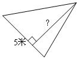

# Mathematics (Grade 5)

**ID**: 0f46a32f
**难度**: medium_easy
**题型**: fill_in_the_blank

## 题目
一个三角形的布料面积是45平方米，一条边长为5米，求这条边上的高为多少米？

## 解答

**答案**: 18

1. Step1:明确三角形面积公式为S = ah÷2（其中S表示面积，a表示底边长，h表示这条底边上的高）
2. Step2:由面积公式变形可得h = 2S÷a
3. Step3:已知S = 45平方米，a = 5米，将其代入变形后的公式h = 2S÷a，即h = 2×45÷5
4. Step4:先计算2×45 = 90
5. Step5:再计算90÷5 = 18，得到这条边上的高h为18米

## 知识点

**知识点**:
  - 三角形的周长和面积

---
