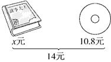

# Mathematics (Grade 5)

**ID**: 1bc11b71
**难度**: medium_easy
**题型**: fill_in_the_blank

## 题目
看图列方程。(不用解方程)

## 解答

**答案**: x＋10.8＝14

1. Step1:观察图片可知，书的价格是x元，光盘价格是10.8元，书和光盘的总价格是14元。
2. Step2:根据上述信息，可得出书的价格加上光盘的价格等于总价格这一数量关系。
3. Step3:依据数量关系列出方程x＋10.8＝14

## 知识点

**知识点**:
  - 小学数学;数与代数;应用题;列方程解应用题;列方程解应用题（两步需要逆思考）

---
