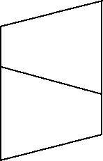

# Mathematics (Grade 5)

**ID**: cdf6a577
**难度**: medium_easy
**题型**: fill_in_the_blank

## 题目
下边平行四边形的面积是72平方分米，它是由两个完全一样的梯形拼成的．每个梯形的面积是________平方分米

## 解答

**答案**: 36

1. Step1:已知平行四边形是由两个完全一样的梯形拼成的，这意味着平行四边形的面积等于两个梯形面积之和。
2. Step2:已知平行四边形面积是72平方分米，那么每个梯形的面积就是平行四边形面积除以2，即72÷2=36平方分米。

## 知识点

**知识点**:
  - 小学数学;图形与几何

---
