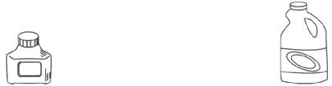

# Mathematics (Grade 5)

**ID**: d1f66aef
**难度**: medium_easy
**题型**: fill_in_the_blank

## 题目
在括号内填上合适的容积单位。

一瓶墨水约50（____）  一桶色拉油约5（________）

## 解答

**答案**: mL, L

1. Step1:根据生活常识和对容积单位大小的认识，墨水的容积相对较小，通常用毫升（mL）作为单位，所以一瓶墨水约50mL。
2. Step2:色拉油的容积相对较大，一般用升（L）作为单位，所以一桶色拉油约5L。

## 知识点

**知识点**:
  - 小学数学;图形与几何;测量;常见的体积单位及换算;体积、容积及其单位

---
