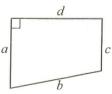

# Mathematics (Grade 5)

**ID**: 758282b8
**难度**: medium_easy
**题型**: multiple_choice

## 题目
下面梯形的上底和下底分别是（  ）
A．a和b
B．b和d
C．b和c
D．a和c

## 解答

**答案**: D

1. Step1:明确梯形的定义为有一组对边互相平行的四边形
2. Step2:观察图形，找出互相平行的一组对边
3. Step3:确定这组互相平行的对边为a和c
4. Step4:得出梯形的上底和下底分别是a和c，对应选项D

## 知识点

**知识点**:
  - 梯形的特征及分类；用字母表示数．

---
