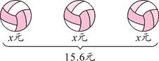

# Mathematics (Grade 5)

**ID**: 0ecfa96e
**难度**: medium_easy
**题型**: short_answer

## 题目
看图列方程。

## 解答

**答案**: 3x＝15.6

1. Step1:观察图片可知有3个排球，每个排球价格是x元，总价是15.6元
2. Step2:根据“单价×数量=总价”的关系，可列出方程3x＝15.6

## 知识点

**知识点**:
  - 小学数学;数与代数;式与方程;方程的意义

---
