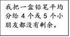

# Mathematics (Grade 5)

**ID**: 109723ff
**难度**: medium_easy
**题型**: short_answer

## 题目
这盒铅笔有多少支？（一盒铅笔不超过30支）

## 解答

**答案**: 20支

1. Step1:因为铅笔平均分给4个或5个小朋友都没有剩余，所以铅笔的数量是4和5的公倍数。
2. Step2:4和5是互质数，它们的最小公倍数是4×5 = 20。
3. Step3:由于一盒铅笔不超过30支，4和5的公倍数在30以内的只有20，所以这盒铅笔有20支。

## 知识点

**知识点**:
  - 小学数学;数与代数;数的认识;整数的认识;因数与倍数;公倍数与最小公倍数

---
