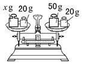

# Mathematics (Grade 5)

**ID**: 18bf33b3
**难度**: medium_easy
**题型**: short_answer

## 题目
看图列方程计算

## 解答

**答案**: 50

1. Step1:根据天平平衡原理，天平两边重量相等，可列出方程20 + x = 50 + 20
2. Step2:根据等式的性质，等式两边同时减去20，得到x = 50 + 20 - 20
3. Step3:计算50 + 20 - 20的结果，得出x = 50

## 知识点

**知识点**:
  - 小学数学;数与代数;应用题;常见的数学问题;图文问题

---
