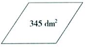

# Mathematics (Grade 5)

**ID**: 1a39cdaf
**难度**: medium_easy
**题型**: short_answer

## 题目
下面是一块平行四边形广告牌。如果广告牌的底是20分米，那么它所对应的高是多少分米？

## 解答

**答案**: 17.25

1. Step1:根据平行四边形面积公式S = 底×高，已知面积S为345平方分米，底为20分米，要求高，可变形公式为高 = 面积÷底。
2. Step2:将面积345平方分米和底20分米代入变形后的公式，即计算345÷20。
3. Step3:得出345÷20的结果为17.25分米，此即为所求的高。

## 知识点

**知识点**:
  - 小学数学;数与代数;应用题;面积、体积相关应用题;平行四边形相关的应用题

---
