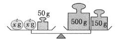

# Mathematics (Grade 5)

**ID**: 1c7572e9
**难度**: medium_easy
**题型**: short_answer

## 题目
看图列方程，并求出方程的解。

## 解答

**答案**: x＝300

1. Step1:根据天平平衡原理，天平左边物体质量等于右边物体质量，列出方程2x + 50 = 500 + 150
2. Step2:先计算方程右边500 + 150 = 650，得到2x + 50 = 650
3. Step3:方程两边同时减去50，即2x + 50 - 50 = 650 - 50，得到2x = 600
4. Step4:方程两边同时除以2，即2x÷2 = 600÷2，解得x = 300

## 知识点

**知识点**:
  - 小学数学;数与代数;应用题;常见的数学问题;图文问题

---
